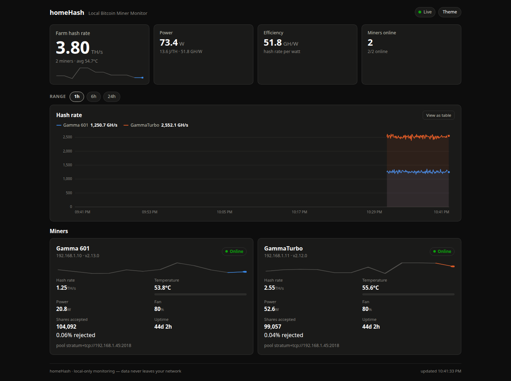

# homeHash

[](https://github.com/gregweir/homeHash/actions/workflows/ci.yml)
[](LICENSE)

A lightweight, local-only monitoring dashboard for home Bitcoin miners.



## Purpose

homeHash discovers Bitaxe miners on your local network and shows whether they're actually mining — hash rate, temperature, pool connection, uptime. No cloud accounts. No remote servers. Just a simple dashboard that runs on your LAN.

## Philosophy

- **Local-only:** Data never leaves your network
- **Single binary:** One file to run, no dependencies
- **Zero config:** Auto-discovers miners via mDNS
- **Anti-cloud:** The opposite of Hive OS and Braiins OS — built for the home miner with 1–10 units, not the industrial farm with 1000+

## Status

Early development. Bitaxe Gamma/Ultra support implemented and tested against
real hardware. The dashboard, SQLite history, live SSE stream, network
discovery, and alerting are all working; architecture supports additional
miners via driver plugins.

## Quick Start

```bash
# Build
go build -o homeHash ./cmd/homeHash

# Run against your Bitaxes (comma-separated IPs), 5s polling
HOMEHASH_MINER=192.168.1.10,192.168.1.11 HOMEHASH_INTERVAL=5 ./homeHash

# Open browser
open http://localhost:8080
```

Configuration is all environment variables:

| Variable | Default | Meaning |
|----------|---------|---------|
| `HOMEHASH_PORT` | 8080 | HTTP server port |
| `HOMEHASH_DB` | ./homehash.db | SQLite database path |
| `HOMEHASH_INTERVAL` | 60s | Polling interval (seconds or Go duration, e.g. `5` or `90s`) |
| `HOMEHASH_MINER` | — | Seed miner IPs (or `ip:port`), comma-separated |
| `HOMEHASH_DISCOVERY` | true | Network discovery toggle |
| `HOMEHASH_DISCOVERY_INTERVAL` | 5m | How often to rescan for new miners |
| `HOMEHASH_ALERTS` | true | Alerting loop toggle |
| `HOMEHASH_ALERT_WEBHOOK_URL` | — | Discord webhook URL (empty: log-only alerts) |
| `HOMEHASH_ALERT_TEMP_WARN` | 75 | Warn above this board temperature (°C) |
| `HOMEHASH_ALERT_TEMP_CRITICAL` | 85 | Critical above this (°C) |
| `HOMEHASH_ALERT_OFFLINE_AFTER` | 10m | Miner offline when last poll is older than this |
| `HOMEHASH_ALERT_COOLDOWN` | 15m | Re-alert the same condition after this long |
| `HOMEHASH_ALERT_INTERVAL` | 30s | Alert evaluation cadence |
| `HOMEHASH_CONTROL` | false | Write access: settings changes + pause/resume |
| `HOMEHASH_CONTROL_FREQ_MIN` / `HOMEHASH_CONTROL_FREQ_MAX` | 100 / 750 | Accepted ASIC frequency range (MHz) |
| `HOMEHASH_CONTROL_VOLT_MIN` / `HOMEHASH_CONTROL_VOLT_MAX` | 900 / 1300 | Accepted core voltage range (mV) |

### Miner control (optional, off by default)

With `HOMEHASH_CONTROL=1`, each miner card gains **Pause/Resume** and
**Settings** controls: stop or restart hashing, and change the ASIC frequency
or core voltage. The firmware applies both live (no restart) and persists
them, so a change survives reboots.

homeHash clamps accepted values before they ever reach the device — the
firmware itself would accept 1–65535 for both, which is no protection. The
defaults (100–750 MHz, 900–1300 mV) are sane for Gamma-family boards; widen
them only if you know your silicon.

A few things worth knowing before enabling:

- **It's your hardware at your own risk.** Increasing frequency/voltage raises
  board temperature and the invalid-share rate; go up in small steps and watch
  the dashboard, and expect the firmware's overheat safe-mode to auto-reduce
  settings if a board runs hot.
- **No authentication.** When control is on, anyone on your LAN can pause your
  miners — the whole HTTP surface is deliberately unauthenticated and
  LAN-only. Don't run homeHash on a shared network, and don't port-forward it.

Both features use the same guard rails as everything else: see
`docs/API.md` (`POST /api/miners/{id}/settings`, `/pause`, `/resume`).

### Discovery & alerts

Every `HOMEHASH_DISCOVERY_INTERVAL`, homeHash scans the local network for
miners:

1. **mDNS** — Bitaxes running esp-miner advertise `_axeos._sub._http._tcp`
   (plus plain `_http._tcp` as a fallback). Found entries are verified over
   real HTTP before being claimed; model/firmware come from the DNS-SD TXT
   records.
2. **IP scan fallback** — the private /24 of each local interface is probed
   for hosts answering on `:80` with an axeOS API (32 concurrent probes).

Discovered miners are added to the store **only if new**
(`UpsertMinerIfNew`): they never overwrite a known miner's poller-enriched
identity, and everything found is verified before it's trusted.

Alerting runs on its own loop, reading the store: a miner whose last
successful poll is older than `HOMEHASH_ALERT_OFFLINE_AFTER` alerts offline
(critical), once; a miner that returns alerts recovery (info); board
temperature above `TEMP_WARN` warns and above `TEMP_CRITICAL` escalates to
critical, repeating only after `ALERT_COOLDOWN`, and recovers once below
range. Alerts go to the process log by default, or to Discord when
`HOMEHASH_ALERT_WEBHOOK_URL` is set, and every alert is kept in the store:
the dashboard's bell shows an unread badge and lists recent alerts (`GET
/api/alerts`, see `docs/API.md`).

## Architecture

### Driver Interface

All miner support is implemented via the `MinerDriver` interface:

```go
type MinerDriver interface {
    Name() string                    // "bitaxe", "nerdminer", etc.
    Discover() ([]Miner, error)      // Find miners on network
    Poll(miner Miner) (Stats, error) // Collect current stats
    SupportedModels() []string       // "Bitaxe Gamma", "Bitaxe Ultra", etc.
}

// Drivers may implement InfoUpdater to enrich miner identity (model,
// firmware, MAC, pool) from the device itself after a successful poll.
type InfoUpdater interface {
    UpdateInfo(miner Miner) (Miner, error)
}

// Drivers may implement ControlUpdater to offer write access (settings,
// pause, resume) behind HOMEHASH_CONTROL.
type ControlUpdater interface {
    ApplySettings(miner Miner, patch SettingsPatch) error
    Pause(miner Miner) error
    Resume(miner Miner) error
}
```

### Current Drivers

| Driver | Status | Tested Hardware |
|--------|--------|-----------------|
| Bitaxe | ✅ Implemented | Gamma 601 (axeOS v2.15.3), GammaTurbo (axeOS v2.12.0) |
| NerdMiner | 📝 Stubbed | Needs community contribution |

### Data Model

```go
type Miner struct {
    ID        string    // e.g. "bitaxe-192-168-1-10"
    IP        string    // Local IP address (may include port)
    Model     string    // "Gamma 601", etc.
    Driver    string    // "bitaxe"
    PoolURL   string    // Current pool
    Firmware  string    // Firmware version
    MAC       string    // MAC address
    LastSeen  time.Time
}

type Stats struct {
    HashRateGH   float64   // Current hash rate in GH/s
    Accepted     int64     // Lifetime accepted shares
    Rejected     int64     // Lifetime rejected shares
    TemperatureC float64   // Board temperature
    FanSpeed     int       // Fan speed percentage
    PowerW       float64   // Power draw in watts
    Uptime       time.Duration
    Timestamp    time.Time
    Frequency    float64   // Configured ASIC frequency (MHz)
    CoreVoltageMv int      // Configured core voltage (mV)
    Paused       bool      // True while mining is paused
}
```

### Tech Stack

| Component | Technology |
|-----------|-----------|
| Backend | Go 1.26+ (stdlib net/http only) |
| Database | SQLite via modernc.org/sqlite (pure Go, no CGO) |
| Frontend | Vanilla JS + hand-rolled SVG charts, embedded in the binary |
| Discovery | mDNS (zeroconf library) + IP fallback |
| Deployment | Single binary + systemd service |

### Project Structure

```
homeHash/
├── cmd/homeHash/          # Entry point
├── internal/
│   ├── api/              # HTTP handlers, routes, SSE
│   ├── config/           # Config parsing, defaults
│   ├── discovery/        # Network scanning, mDNS
│   ├── poller/           # Poll loop: driver → stats → store
│   ├── store/            # SQLite persistence (history + inventory)
│   └── drivers/
│       ├── bitaxe/       # Bitaxe implementation (axeOS /api/system/info)
│       └── base/         # Shared driver interface
├── web/                  # Dashboard UI, embedded via go:embed
│   ├── embed.go          # Embedded filesystem
│   ├── index.html        # Single page, no framework
│   └── static/           # CSS, JS, favicon
├── docs/
│   └── API.md            # Full HTTP API documentation
└── README.md             # This file
```

### The Dashboard

The UI ships inside the binary (`go:embed`) — one file to run, no CDN, works
on an offline LAN. It shows:

- **KPI row** — farm hash rate (hero tile with sparkline), total power,
  efficiency (GH/W), miners online
- **Hash rate chart** — per-miner lines over the last 1h/6h/24h, crosshair
  tooltip, legend, and a table view for accessibility
- **Miner cards** — live sparkline, hash rate, temperature meter, power, fan,
  shares, uptime, pool URL, online status
- **Miner control** (optional, `HOMEHASH_CONTROL=1`) — pause/resume mining and
  change frequency/voltage per miner, with an old → new preview before apply
- **Live updates** via Server-Sent Events (`/api/events`); connection chip
  shows when the stream reconnects

Light and dark themes follow your OS preference; the header button selects
one explicitly. No external JS libraries — everything is vanilla.

## API Contract

The full contract lives in [docs/API.md](docs/API.md). Quick list:

- `GET /api/miners` — List all miners with latest stats
- `GET /api/miners/{id}` — Single miner details + last 24h history
- `GET /api/miners/{id}/history?hours=N` — Historical stats (1–168h)
- `GET /api/miners/{id}/export/{csv,json}?hours=N` — Download history as CSV/JSON
- `GET /api/alerts?limit=N` — Recent alerts, newest first
- `GET /api/stats` — Aggregate farm stats (hash rate, power, efficiency)
- `GET /api/events` — Server-Sent Events live snapshots
- `GET /api/health` — Service health check
- `POST /api/miners/{id}/settings` — Change frequency / core voltage (HOMEHASH_CONTROL)
- `POST /api/miners/{id}/pause` / `POST /api/miners/{id}/resume` — Stop/restart hashing (HOMEHASH_CONTROL)

### Response Format

```json
{
  "miners": [
    {
      "id": "miner-abc123",
      "ip": "192.168.1.45",
      "model": "Bitaxe Gamma",
      "driver": "bitaxe",
      "pool_url": "stratum+tcp://pool.ocean.xyz:3334",
      "firmware": "2.1.4",
      "status": "online",
      "last_seen": "2026-10-09T18:49:13Z",
      "stats": {
        "hash_rate_gh": 450.2,
        "accepted": 154320,
        "rejected": 142,
        "temperature_c": 58.4,
        "fan_speed": 72,
        "uptime_seconds": 86400,
        "timestamp": "2026-10-09T18:49:13Z"
      }
    }
  ]
}
```

## Bitaxe API

**Tested against real hardware:** Gamma 601 on axeOS v2.13.0 and GammaTurbo on
axeOS v2.12.0. Both expose everything on one endpoint:

- `GET /api/system/info` — device info **and** current mining stats in one
  object: `hashRate` (GH/s directly), `power` (watts), `temp` / `vrTemp`,
  `fanspeed` (lowercase), `sharesAccepted` / `sharesRejected`, `uptimeSeconds`,
  `hostname`, `stratumURL` / `stratumPort`, `macAddr`, `version`

```json
{
  "hostname": "Gamma 601",
  "version": "v2.13.0",
  "hashRate": 1265.31,
  "power": 20.9,
  "temp": 54.4,
  "fanspeed": 80,
  "sharesAccepted": 103039,
  "sharesRejected": 58,
  "uptimeSeconds": 3800135,
  "stratumURL": "192.168.1.45",
  "stratumPort": 2018,
  "macAddr": "AA:BB:CC:DD:EE:FF"
}
```

The driver polls only this endpoint; older documentation referencing
`/api/stats` or `/api/summary` does not apply to current axeOS firmwares.

## Adding a New Miner Driver

1. Create `internal/drivers/<minername>/`
2. Implement the `MinerDriver` interface
3. Register in `internal/drivers/registry.go`
4. Add tests with mock HTTP server
5. Document the miner's API endpoints in `docs/API.md`

## Installation

### Prebuilt binaries (easiest)

Grab the archive for your platform from the
[latest release](https://github.com/gregweir/homeHash/releases/latest),
unpack it, and run the binary. It discovers miners on its own; add
`HOMEHASH_MINER` if you'd rather seed IPs explicitly.

### macOS and Linux (Homebrew)

```bash
brew tap gregweir/tap
brew install homehash
```

### Windows

Download `homeHash_*_windows_amd64.zip`, extract it, and double-click
`homeHash.exe` — then open http://localhost:8080. On first launch, Windows
Firewall may ask permission for network discovery: allow it (only your local
network is contacted).

### From Source

Requires Go 1.26+:

```bash
git clone https://github.com/gregweir/homeHash.git
cd homeHash
go build -o homeHash ./cmd/homeHash
```

Check what you're running with:

```bash
homeHash --version
```

### systemd Service (Linux)

Copy `systemd/homeHash.service` to `/etc/systemd/system/`:

```bash
sudo cp systemd/homeHash.service /etc/systemd/system/
sudo systemctl enable homeHash
sudo systemctl start homeHash
```

## Development

### The `make check` Gate

```bash
make check   # build + vet + gofmt (zero diff) + all tests
```

### Adding Bitaxe Models

The Bitaxe driver reads the model from the device's own `/api/system/info`
response, so new models appear without any mapping table. Driver unit notes in
`internal/drivers/bitaxe/doc.go` record what real hardware confirmed.

## Roadmap

- [x] Bitaxe Gamma/Ultra support (tested on Gamma 601 + GammaTurbo)
- [x] Web dashboard with graphs (light/dark, live SSE, table view)
- [x] 24-hour SQLite history (WAL, 7-day window, SSE-friendly)
- [x] Network discovery (mDNS + IP scan, verified, add-new-only)
- [x] Alerting (offline / recovery / temperature, log + Discord webhook)
- [x] Alerts surfaced in the dashboard (bell panel, unread badge)
- [x] CSV/JSON history export
- [x] Miner control: frequency/voltage settings + pause/resume (opt-in, off by default)
- [x] Release binaries for Linux/macOS/Windows (amd64 + arm64)
- [ ] Email notifier
- [ ] NerdMiner support (needs hardware donation or community PR)
- [ ] Tailscale integration

## License

MIT License — see LICENSE file.

## Author

Greg Weir ([Tartanleaf](https://www.tartanleaf.com/))

Built by the author of the book *Bitcoin Mining with Bitaxe*.
